<!-- Banner do topo (gerado pelo capsule-render) -->

<!-- Comanda: o pedido de hoje, do balcão para o código -->

  

  

---

## 👩‍💻 Sobre mim

Sou estudante do **4º período de Sistemas de Informação** na **UFPB, Campus IV** (Rio Tinto, PB).

**Antes do código, veio o balcão.** Sou técnica em Comércio, já estagiei na área e ajudo
na pastelaria da família. Foi lá que aprendi que um sistema só é bom quando resolve o
problema de quem está do outro lado. Por isso gosto de **entender a regra de negócio
antes de escrever a primeira linha**, e de conseguir explicar cada parte do que construo.

- 🎯 Foco: **desenvolvimento backend com Java**, ampliando aos poucos para o frontend
- 🧪 Me importo com: **testes, segurança** e operações que não podem dar errado (como dinheiro)
- 🧭 Também me interessam: modelagem de dados, ética em Engenharia de Software e uso responsável de IA
- 🌍 Gosto de projetos com **impacto social** e que apoiam a aprendizagem

---

## 🛠️ Tecnologias

  

---

## 🚀 Projetos

### 🩺 Vitallis · *projeto pessoal*
Sistema para **profissionais autônomos da saúde**. O backend cuida de contas, pacientes,
agendamentos e controle financeiro: cobranças, pagamentos, pacotes de sessões e créditos.
A arquitetura é **multi-tenant**: cada profissional só enxerga os próprios dados, com
controle de acesso por conta e papel. Também cuido da **consistência das operações
financeiras**, usando transações para que um pagamento nunca fique registrado pela metade.
`Java 25` `Spring Boot` `Spring Security` `JWT (RSA)` `PostgreSQL` `Flyway` `Testcontainers`

### 🥟 Sistema de gestão para pastelaria e peixaria · *projeto pessoal, em uso real*
Nasceu de uma necessidade da minha família: tirar o controle do caderno. Tem caixa do dia,
vendas, despesas, repasses ao entregador e relatórios. Funciona no computador e no celular.
O escopo mudou várias vezes conforme eu entendia melhor o negócio.
Tem **221 testes automatizados**, com integração contra um PostgreSQL real.
`Java 25` `Spring Boot` `PostgreSQL` `Flyway` `Testcontainers` `JavaScript`

### 📚 EDUPlanner · *projeto acadêmico em equipe*
Organizador de estudos com disciplinas, tarefas, eventos, anotações e dashboard.
O backend usa **Javalin** com páginas geradas em **Thymeleaf**, acesso ao banco
direto por **JDBC** (com pool de conexões HikariCP) e login por **JWT** com senhas em
**BCrypt**. Os testes usam JUnit e Mockito, mais testes de integração que fazem
requisições HTTP reais. O projeto tem uma pipeline de integração e entrega no **GitHub Actions**.
`Java 25` `Javalin` `Thymeleaf` `PostgreSQL` `JDBC` `JWT` `Docker` `GitHub Actions`

🔒 Alguns repositórios são privados. Posso mostrar o código e explicar as decisões numa conversa.

---

## 🦥 SLOTH: Liga Acadêmica de Ética em Engenharia de Software

Sou **Diretora de Pesquisa** da SLOTH, na UFPB Campus IV. A liga tem foco em formação
crítica, impacto social e **uso ético de IA no desenvolvimento de software**. Organizo as
leituras e discussões de artigos, as duplas de pesquisa e a comunicação com integrantes
e professores.

---

## 🌱 Aprendendo agora

| | Estudando | Assuntos |
|---|---|---|
| 🟨 | **JavaScript** | funções, objetos, protótipos, herança e polimorfismo |
| ☕ | **Backend Java** | arquitetura, segurança e regras de negócio mais complexas |
| 🌳 | **Estruturas de dados** | árvores de busca, heaps, HeapSort e Skip List |
| 🇺🇸 | **Inglês** | vocabulário, verbos e tempos verbais |

**Próximos passos:** TypeScript ➜ React, para construir interfaces e conectá-las ao backend.

---

  <i>"Um sistema bom é aquele que alguém consegue usar no dia mais corrido da semana."</i>

