<!-- Banner do topo (gerado pelo capsule-render) -->

<!-- Comanda: o pedido de hoje, do balcão para o código -->

  

  

---

## 👩‍💻 Sobre mim

Sou estudante do **4º período de Sistemas de Informação** na **UFPB, Campus IV** (Rio Tinto, PB).

**Antes do código, veio o balcão.** Sou técnica em Comércio, já estagiei na área e ajudo
na pastelaria da família. Foi lá que aprendi que um sistema só é bom quando resolve o
problema de quem está do outro lado. Por isso gosto de **entender a regra de negócio
antes de escrever a primeira linha**, e de conseguir explicar cada parte do que construo.

- 🎯 **Foco:** desenvolvimento **full stack**. Minha base é o backend com Java, e estou construindo o lado do frontend (JavaScript, depois TypeScript e React)

- 🧪 **Me importo com:** testes, segurança e operações que não podem dar errado (como dinheiro)

- 🧭 **Também me interessam:** modelagem de dados, ética em Engenharia de Software e uso responsável de IA

- 🌍 **Gosto de** projetos com impacto social e que apoiam a aprendizagem

---

## 🛠️ Tecnologias

  

---

## 🚀 Projetos

Três projetos, cada um mostrando uma parte do que sei fazer.

<table>
  <tr>
    <th colspan="2" align="left">🥟 Galo &amp; Cia · sistema de gestão para pastelaria e peixaria Projeto pessoal · em uso real</th>
  </tr>
  <tr>
    <td width="130" valign="top"><b>O que é</b></td>
    <td>Nasceu de uma necessidade da minha família: tirar o controle do caderno. Hoje está <b>no ar</b>, com uma parte aberta ao público.</td>
  </tr>
  <tr>
    <td width="130" valign="top"><b>O que faz</b></td>
    <td><ul>
      <li><b>Cardápio público (sem login):</b> o cliente vê o que tem hoje, escolhe os itens, retirada ou entrega, Pix ou dinheiro, e pede pelo WhatsApp com o pedido já escrito.</li>
      <li><b>Painel interno (com login):</b> caixa do dia, vendas, despesas, repasses ao entregador e relatórios, no computador e no celular.</li>
    </ul></td>
  </tr>
  <tr>
    <td width="130" valign="top"><b>Destaques</b></td>
    <td><ul>
      <li>221 testes automatizados, com integração contra um PostgreSQL real.</li>
      <li>O escopo mudou várias vezes conforme eu entendia melhor o negócio.</li>
    </ul></td>
  </tr>
  <tr>
    <td width="130" valign="top"><b>Tecnologias</b></td>
    <td><code>Java 25</code> <code>Spring Boot</code> <code>PostgreSQL</code> <code>Flyway</code> <code>Testcontainers</code> <code>JavaScript</code> <code>Docker</code></td>
  </tr>
  <tr>
    <td width="130" valign="top"><b>Experimente</b></td>
    <td>🎮 <a href="https://cybellesantos-byte.github.io/galo-e-cia-demo/"><b>Testar a demo do painel</b></a> 🍽️ <a href="https://cybellesantos-byte.github.io/galo-e-cia-demo/cardapio.html"><b>Ver o cardápio do cliente</b></a> Tudo fictício: dá para vender, abrir e fechar o caixa e ver os relatórios. O pedido do cardápio só mostra a mensagem, não envia nada.</td>
  </tr>
</table>

<table>
  <tr>
    <th colspan="2" align="left">🩺 Vitallis · sistema para profissionais autônomos da saúde Projeto pessoal</th>
  </tr>
  <tr>
    <td width="130" valign="top"><b>O que é</b></td>
    <td>Backend com contas, pacientes, agendamentos e controle financeiro (cobranças, pagamentos, pacotes de sessões e créditos).</td>
  </tr>
  <tr>
    <td width="130" valign="top"><b>Destaques</b></td>
    <td><ul>
      <li><b>Multi-tenant:</b> cada profissional só enxerga os próprios dados, com controle de acesso por conta e papel.</li>
      <li><b>Dinheiro sem erro:</b> transações garantem que um pagamento nunca fique registrado pela metade.</li>
    </ul></td>
  </tr>
  <tr>
    <td width="130" valign="top"><b>Tecnologias</b></td>
    <td><code>Java 25</code> <code>Spring Boot</code> <code>Spring Security</code> <code>JWT (RSA)</code> <code>PostgreSQL</code> <code>Flyway</code> <code>Testcontainers</code></td>
  </tr>
</table>

<table>
  <tr>
    <th colspan="2" align="left">📚 EDUPlanner · organizador de estudos Projeto acadêmico em equipe</th>
  </tr>
  <tr>
    <td width="130" valign="top"><b>O que é</b></td>
    <td>Organizador de estudos com disciplinas, tarefas, eventos, anotações e dashboard.</td>
  </tr>
  <tr>
    <td width="130" valign="top"><b>Destaques</b></td>
    <td><ul>
      <li><b>Backend:</b> Javalin com páginas em Thymeleaf e acesso ao banco direto por JDBC (pool HikariCP).</li>
      <li><b>Segurança:</b> login com JWT e senhas protegidas com BCrypt.</li>
      <li><b>Testes e entrega:</b> JUnit, Mockito e testes HTTP de integração, com pipeline no GitHub Actions.</li>
    </ul></td>
  </tr>
  <tr>
    <td width="130" valign="top"><b>Tecnologias</b></td>
    <td><code>Java 25</code> <code>Javalin</code> <code>Thymeleaf</code> <code>PostgreSQL</code> <code>JDBC</code> <code>JWT</code> <code>Docker</code> <code>GitHub Actions</code></td>
  </tr>
</table>

🔒 Alguns repositórios são privados. Posso mostrar o código e explicar as decisões numa conversa.

---

## 🦥 SLOTH: Liga Acadêmica de Ética em Engenharia de Software

Sou **Diretora de Pesquisa** da SLOTH, na UFPB Campus IV.

A liga tem foco em formação crítica, impacto social e **uso ético de IA no desenvolvimento de software**.

Organizo as leituras e discussões de artigos, as duplas de pesquisa e a comunicação com integrantes e professores.

---

## 🌱 Aprendendo agora

| | Estudando | Assuntos |
|---|---|---|
| 🟨 | **JavaScript** | funções, objetos, protótipos, herança e polimorfismo |
| ☕ | **Backend Java** | arquitetura, segurança e regras de negócio mais complexas |
| 🌳 | **Estruturas de dados** | árvores de busca, heaps, HeapSort e Skip List |

**Próximos passos:** TypeScript ➜ React, para construir interfaces completas e conectá-las ao meu backend em Java.

---

  <i>"Um sistema bom é aquele que alguém consegue usar no dia mais corrido da semana."</i>

