<!-- Topo: nome e constelação de tecnologias, num céu só (assets/topo.svg) -->

  
  
  

 

Sou estudante do **4º período de Sistemas de Informação** na **UFPB, Campus IV** (Rio Tinto, PB).

**Antes do código, veio o balcão.** Sou técnica em Comércio, já estagiei na área e ajudo
na pastelaria da família. Foi lá que aprendi que um sistema só é bom quando resolve o
problema de quem está do outro lado. Por isso gosto de **entender a regra de negócio
antes de escrever a primeira linha**, e de conseguir explicar cada parte do que construo.

- 🎯 **Foco:** desenvolvimento **full stack**, com base no backend em Java
- 📚 **Estudando agora:** React, estruturas de dados (árvores de busca, heaps e Skip List) e arquitetura backend
- 🧪 **Me importo com:** testes, segurança e operações que não podem dar errado (como dinheiro)
- 🧭 **Também me interessam:** modelagem de dados, ética em Engenharia de Software e uso responsável de IA
- 🌍 **Gosto de** projetos com impacto social e que apoiam a aprendizagem

 

### 🥟 Galo & Cia

**Gestão de pastelaria e peixaria**, em uso real pela minha família.

Tirou o controle do caderno: caixa, vendas, despesas, repasses e relatórios, mais um
cardápio para o cliente pedir pelo WhatsApp. **291 testes** rodam no GitHub Actions
a cada mudança, e o site só é publicado se todos passarem.

  
  
  

A demo é toda fictícia: dá para vender, abrir e fechar o caixa e ver os relatórios, sem acessar dados reais.

`Java 25` `Spring Boot` `PostgreSQL` `Testcontainers` `JavaScript` `Docker` `GitHub Actions`

### 🩺 Vitallis

**Gestão para profissionais autônomos da saúde**, projeto pessoal: contas, pacientes,
agendamentos e controle financeiro, com cobranças, pagamentos, pacotes de sessões e créditos.

- **Multi-tenant:** cada profissional só enxerga os próprios dados, com controle de acesso por conta e papel.
- **Dinheiro sem erro:** transações garantem que um pagamento nunca fique registrado pela metade.
- **Segurança:** login com Spring Security e JWT assinado com chaves RSA.

`Java 25` `Spring Boot` `Spring Security` `JWT (RSA)` `PostgreSQL` `Flyway` `Testcontainers`

### 📚 EDUPlanner

**Organizador de estudos**, projeto acadêmico em equipe: disciplinas, tarefas, eventos,
anotações e um dashboard com o resumo dos estudos.

- **Backend:** Javalin com páginas em Thymeleaf e acesso ao banco direto por JDBC (pool HikariCP).
- **Segurança:** login com JWT e senhas protegidas com BCrypt.
- **Testes e entrega:** JUnit, Mockito e testes HTTP de integração, com pipeline no GitHub Actions.

`Java 25` `Javalin` `Thymeleaf` `PostgreSQL` `JDBC` `JWT` `Docker` `GitHub Actions`

🔒 Vitallis e EDUPlanner são privados. Posso mostrar o código e explicar as decisões numa conversa.

 

  

 

- 🦥 **Diretora de Pesquisa da SLOTH**, a Liga Acadêmica de Ética em Engenharia de Software da UFPB Campus IV.
  Organizo leituras e discussões de artigos, as duplas de pesquisa e a comunicação com integrantes e professores.
- 📖 Sempre com um livro por perto.
- 🎸 Nas horas livres, violão.

 

  <i>"Um sistema bom é aquele que alguém consegue usar no dia mais corrido da semana."</i>

